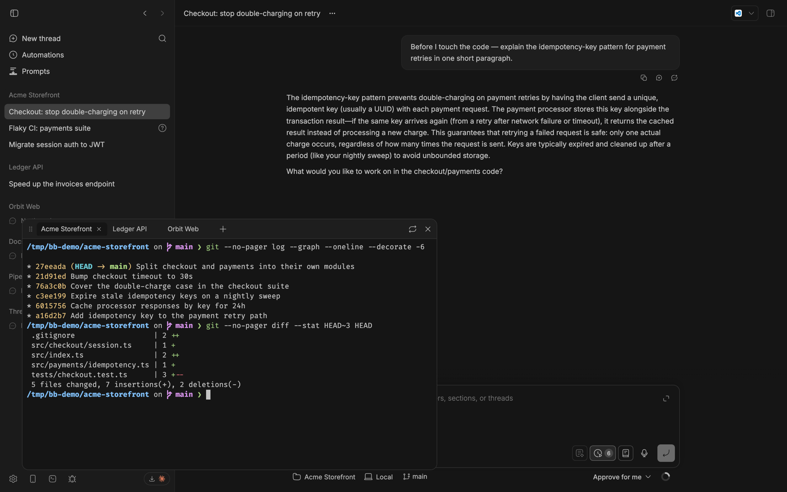
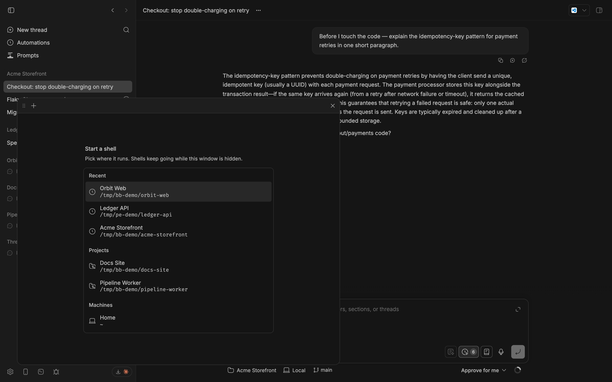
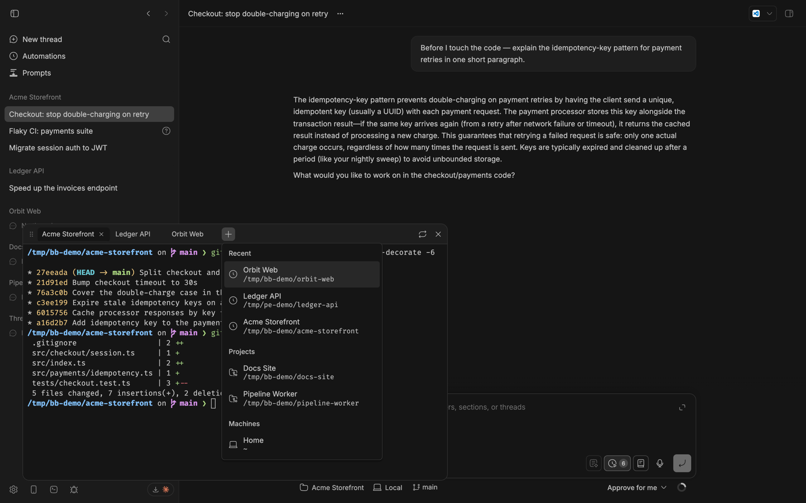
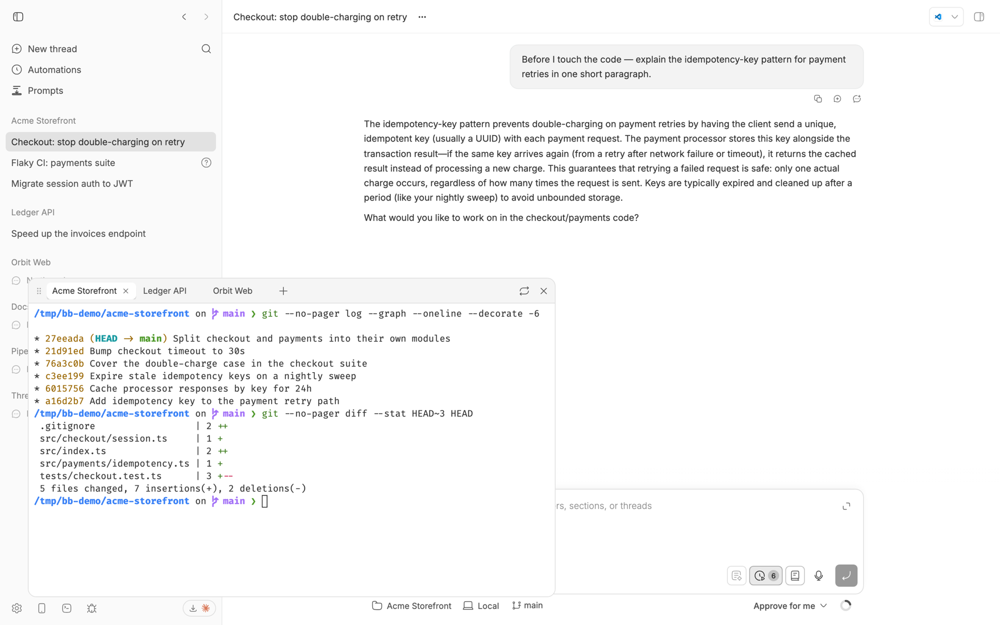

# Floating Terminal

A real terminal that floats over bb. Open it from the sidebar footer or with
`Ctrl+\``, run whatever you need next to the agent that is working, and hide it
again — the shells keep running.



*One window, several shells, sitting over the thread you are reading.*

## Install

```sh
bb plugin install git:https://github.com/vburojevic/bb-plugin-floating-terminal
```

Requires bb >= 0.35. No keys, no setup — the button appears in the sidebar
footer next to Settings the moment it lands.

## What it does

- **Tabs, one shell each.** Every tab is a real PTY on a real machine, not a
  log view. `+` opens another one in any project checkout or any machine's home
  directory — and first in that list, **Here**: the worktree of the thread you
  are looking at, or the project's checkout. `` Ctrl+Shift+` `` opens a shell
  there without the menu.
- **Tabs behave like browser tabs.** Drag one to reorder it, double-click (or
  F2) to give it a name of its own, middle-click to close it, and
  `Cmd/Ctrl+Shift+[` and `]` to step through them. A tab you are not looking at
  gets a dot when it prints something, and a ringed one when it rings the bell —
  so `make; tput bel` in one tab tells you when to come back.
- **Multi-machine.** Every connected bb machine is offered, so a tab can be a
  shell on a remote box. Paths and tab titles keep the machine visible once you
  have more than one, and an offline machine says so instead of failing on click.
- **It survives everything short of a reboot.** Open tabs are persisted, so
  closing the window, reloading the app, or restarting bb reattaches to the
  same shells with their scrollback intact. A shell that died while you were
  away is dropped rather than left as a dead row.
- **Drag it anywhere, resize from any edge.** The position is remembered, and
  the whole window stays inside bb — on a narrower screen, or an iPad turned to
  portrait, it comes back on screen rather than with its hide button off the
  edge. It rests in the bottom-left corner with the same inset on every edge,
  which is also the origin the open animation grows from, so it reads as coming
  out of the button that opened it.
- **Restart in place.** Restart, in the `⋯` menu, kills a tab's shell and
  starts a fresh one in the same directory, keeping the tab — and its name —
  where it is. It used to be a button beside hide; a one-click way to kill a
  running dev server belongs one menu deeper.
- **Find in scrollback.** `Cmd/Ctrl+F` inside the terminal (or the `find` key
  on the mobile bar) opens a small find bar: matches highlighted, counted, and
  walked with Enter / Shift+Enter, with switches for case and regular
  expressions. Escape puts focus straight back at the prompt.
- **Lay it out in one click.** Maximize — the button, or double-clicking the
  title bar — grows the window to the viewport minus a sliver and restores it
  exactly. The `⋯` menu also snaps it to the left or right half, or to a
  full-width strip along the bottom the way an editor's terminal panel sits.
- **Never lose the prompt.** Scroll up into history and a small pill appears —
  "Latest", or "New output" once something has landed below you. It stays out
  of the way in `vim` and `less`, where there is no scrollback to lose.
- **Right-click for the rest.** Copy, paste, select all, find, clear. bb's
  desktop app shows no context menu of its own, so before this a right-click
  in the terminal did nothing at all.
- **Text size per device.** `⋯` → Text size steps it up and down, remembered
  on that device only: the size that reads well on a laptop is not the one
  that reads well on a phone.
- **The same terminal bb runs.** WebGL rendering, Unicode 11 widths, clickable
  links, bb's Nerd Font stack, 10 000 lines of scrollback — so a powerline
  prompt, a box-drawing TUI, and an emoji all land the same way they do in bb's
  own terminal panel.

### It works with the agent, not beside it

The terminal is next to an agent for a reason, so text crosses between them:

- **Paste into terminal.** Every chat message, and the menu that appears when
  you select text in one, has a *Paste into terminal* action. On a selection it
  takes the selection; on a whole message it takes the first shell code block.
  The command lands at the prompt and waits for Enter — an agent's suggestion
  is something to read before it runs. With no shell open it starts one in the
  thread's worktree first. A multi-line command goes to the clipboard instead
  when the shell has not turned on bracketed paste, which is what stops it from
  running line by line as it lands.
- **Ask the agent.** Select output in the terminal and a pill offers to send it
  to the thread's composer, fenced, with the caret placed after it — the build
  error becomes a question in one click. Without a selection, the `⋯` menu and
  the right-click menu send the recent tail of the scrollback.
- **Palette commands.** *Floating Terminal: New shell here*, *New shell in…*,
  *Show or hide*, *Find*, *Clear* and *Restart* are in bb's quick palette
  (`Cmd/Ctrl+Shift+P`), and any of them can be given a shortcut in Settings →
  Keyboard.

### It asks where, not what



*With no shell running, the window offers directories rather than a blank pane.*

The order is the design. A flat dump of every project and machine is a filing
cabinet; putting the directory you are looking at first, and the ones you
actually opened after it, makes the list answer "where do you want to work".
Once there are enough directories to stop being scannable, the list grows a
search field.



*The `+` menu renders the same picker, so the vocabulary never shifts.*

### On a phone it stops being a window

Below bb's compact-viewport breakpoint the window becomes a sheet: it fills the
viewport minus one even inset — measured from the safe area, so it clears a
notch and a home indicator — over a blurred backdrop, and drag and resize are
not installed at all. A 760x460 window you drag around a phone screen is a
desktop idea in the wrong clothes; at that width it either covers everything
anyway or is too small to read, and the drag handle only fights the scroll
gesture. Tapping the backdrop hides it, the same as the close button.

**It gets out of the keyboard's way.** Opening the software keyboard does not
change the layout viewport on iOS, so a fixed element keeps its full height and
the prompt ends up behind the keys. The sheet takes its height and offset from
`visualViewport` instead, so it shrinks to whatever is still visible and the
prompt stays where you can see it.

**And it brings the keys a phone does not have.** A row of them sits at the
bottom of the sheet — which is exactly where the keyboard pushes it, so it lands
directly above the keys:

`esc` `tab` `ctrl` `←` `↑` `↓` `→` `^C` `^D` `^Z` `^R` `home` `end` `|` `~`
`/` `-` `_` `find` `paste`, and one to dismiss the keyboard.

Ctrl is a latch, not a chord — you cannot hold two keys on a touch screen — so
tapping it arms the modifier and the next character you type becomes its control
code. Arrows ask the terminal whether it is in application-cursor mode, so they
work in `vim` and `less` as well as at the prompt. Tapping a key does not steal
focus, so the keyboard stays up while you use the bar.

**And you can scroll it with a finger**, which xterm itself cannot do: xterm 6
moved its viewport onto a scrollable widget that only listens for wheel events,
so on a touch screen the scrollbar renders and dragging does nothing. Dragging
here scrolls the scrollback and keeps a little momentum after you let go. In the
alternate screen — `vim`, `less`, `tmux` — there is no scrollback to move
through, so a drag sends cursor keys instead, the same substitution xterm makes
for a wheel there.

### It looks like the rest of your bb



*The xterm palette is derived from bb's live theme tokens, light or dark.*

Background, foreground, cursor and selection come from the window's own card
tokens; the ANSI 16 come from `--ansi-0` … `--ansi-15`, the same tokens bb's
terminal reads. Switch bb to Dracula or Gruvbox and this window's reds and
yellows move with it, instead of sitting on a palette of their own.

**Icons render everywhere.** A shell that prints file icons — `eza --icons`, a
powerline prompt — needs a Nerd Font, and on a desktop that works only because
the OS has one installed to fall back to. A phone has none and bb ships none, so
every icon came out as a tofu box. The plugin now carries the Nerd Font symbol
set itself (`fonts/`), listed last in the stack and restricted by
`unicode-range`, so an installed Nerd Font still wins and this only draws the
codepoints nothing else can.

A tab is named for the directory it runs in, and takes the shell's title when
the shell sets one worth having — `npm run dev` while that is running, back to
`Acme Storefront` at the prompt. With several connected machines it keeps the
host alongside either title, so a remote shell cannot look local. Titles that
only restate the location (`user@host:~/Git/acme`,
`acme-storefront:main`) are ignored, because the tab already says that; the
directory stays in the tooltip either way. The rename lands on the bb session
itself, so `bb terminal list` shows the same name.

## Settings

**bb → Extensions → Floating Terminal**: the default font size, and whether
`` Ctrl+` `` / `` Ctrl+Shift+` `` are bound. The `⋯` menu overrides the size on
one device. Palette commands take shortcuts in **Settings → Keyboard**.

## Keyboard

| Keys | Does |
| --- | --- |
| `` Ctrl+` `` | Show or hide the window — shells keep running |
| `` Ctrl+Shift+` `` | New shell in the thread's worktree (or the project) |
| `Cmd/Ctrl+Shift+[` / `]` | Previous / next tab |
| `Cmd/Ctrl+F` | Find in scrollback |
| `Cmd+K` | Clear scrollback (macOS) |
| `Cmd/Ctrl+C` | Copy the selection; with nothing selected it is `^C` |
| `F2`, double-click a tab | Rename it |
| Middle-click a tab | Close it |
| Double-click the title bar | Maximize or restore |

Both backtick chords match the physical key left of `1`, so they work on
layouts where that key is not a backtick (a cedilla on Croatian, a caret on
German).

## How it fits together

```
app.tsx                       contentScript (React root), sidebar button, palette
│                             commands, the message action, two context overlays
├── lib/controller.ts         external store + command bus; route and composers
└── components/
    ├── floating-terminal.tsx the window — geometry, server sync, layout
    ├── shell-picker.tsx      the directory list, shared by both entry points
    ├── tab-bar.tsx           the tab strip: rename, reorder, activity
    ├── window-menu.tsx       the ⋯ menu
    ├── terminal-overlays.tsx right-click menu, shortcut sheet, pills
    ├── find-bar.tsx          find in scrollback
    └── terminal-view.tsx     one tab's terminal; owns a TerminalPump

server.ts                     RPC over bb.sdk.terminals; tab list in kv
lib/pump.ts                   one xterm <-> one PTY
lib/tabs.ts                   pure reducer for the tab strip
lib/terminal-io.ts            input chunking, shell-title filtering
lib/keys.ts                   the on-screen key bar's sequences
lib/scroll.ts                 finger travel -> whole terminal lines
lib/viewport.ts               visualViewport -> sheet height, keyboard state
lib/scopes.ts                 which directories are offered, and in what order
lib/frame.ts                  drag, resize, clamping, persistence
lib/theme.ts                  bb's oklch tokens -> an xterm palette
lib/rpc.ts                    fetch twin of the useRpc hook
lib/commands.ts               message text -> a command; output -> the composer
lib/host.ts                   feature-detected host APIs (bb's clipboard)
lib/prefs.ts                  the per-device text size
fonts/nerd-symbols.css        generated: the Nerd Font symbol set, inlined
```

Four things are worth knowing before changing it:

**There is no bb React context in the window.** A content script mounts the
root into `document.body`, outside bb's component tree, so `useRpc`,
`useSettings`, and `useBbContext` are unavailable there. `lib/rpc.ts` speaks the
plugin RPC wire format (`POST /api/v1/plugins/<id>/rpc/<method>`) directly and
is typed off the same `rpcContract`. What the window needs from bb's context —
which thread is in view, which composers are on screen — two invisible app
overlays read and report into `lib/controller.ts`. Everything newer than the
vendored SDK types is feature-detected, so on an older bb those parts are
simply absent.

**Everything the window portals must stack above it.** Menus, the phone
drawer and tooltips render outside the window, at the end of `<body>`. The
window sits at z-55 to clear bb's own chrome, so the vendored overlays sit at
z-60 — at bb's default z-50 the `+` menu opened invisibly *behind* the window.
Hit-testing will not catch a regression: while a modal menu is open bb turns
pointer events off on everything else, so `elementFromPoint` sees straight
through the window. Compare z-indices, or look at a screenshot.

**Output is polled, not streamed.** bb exposes terminal output to plugins as a
sequence-numbered buffer, so `lib/pump.ts` polls: 40 ms while bytes are moving,
backing off to 320 ms when the shell is quiet. Tabs behind the active one poll
every 2 s, enough to badge them when they print or ring the bell, and nothing
polls while the window is hidden.

**The server owns the tab list; the client owns status and focus.** Every
response carrying tab state is a `{ revision, tabs, activeTabId }` snapshot, and
the reducer applies one only if its revision is strictly newer than the last.
That is what makes overlapping requests safe: a slow `init` that started before
an `openTab` committed carries an older revision and simply loses, so it can
neither drop the new tab nor resurrect a closed one. Re-syncing on every window
open is also what evicts a tab whose shell died while you were away.

Server-side, every mutation runs inside `serialize`. Each is a read-modify-write
over one kv array with awaits in the middle (`listScopes`, `close`, `create`),
so without the mutex two overlapping calls would read the same snapshot and the
last writer would silently drop the other's session — leaking a live PTY that
appears in no list and can never be closed. This is invisible on localhost,
where a round trip is ~2 ms, and easy to hit on a remote machine at ~100 ms.

## Development

```sh
npm install
npm run typecheck
npm test
bb plugin build
bb plugin dev      # watch: rebuild + reload on every save
```

`npm test` is hermetic. The mobile behaviour is not testable that way — a sheet
that tracks `visualViewport`, a key bar, and touch scrolling only mean anything
against a real browser and a real pty — so that lives in a separate pass:

```sh
npm run test:mobile                            # the whole matrix
node tests/mobile-e2e.mjs webkit "iPhone 14 Pro"
```

It drives a running bb (`BB_APP_URL`, default `http://localhost:38886`) across
Galaxy S9+, iPhone 14 Pro, Pixel 7, the same iPhone under WebKit — the engine
iOS Safari uses — and an iPad, which is over the compact breakpoint and must
stay a window. 35 checks: layout and insets, stacking above bb's chrome, the
`+` menu painting above the window, the directory list, the key bar and its
latch, touch scrolling in both buffers, momentum, the bundled glyphs,
keyboard-aware height, and persistence across a hide and reopen.

It opens one real shell in whichever bb it points at, types only into that one,
closes only that one, and asserts it leaves none behind — so it is safe to run
against the bb you work in. With shells already open, the empty-state checks
report SKIP rather than closing yours to earn them. Touch gestures go over CDP,
so on WebKit those checks report SKIP rather than passing silently.
`PW_CHROMIUM` / `PW_WEBKIT` point it at a browser build when the one Playwright
expects is not the one installed.

`components/ui/` is vendored source you own (the shadcn model) — edit it
freely, it never updates out from under you. Add more from bb's registry, which
is pinned in `components.json` to the bb release you are running:

```sh
npx shadcn add @bb/table @bb/command
```

React, `react-dom/client`, the radix portal primitives, and `sonner` are
provided by the bb app at runtime and never bundled; everything else (xterm,
hugeicons, tailwind-merge) bundles from `node_modules`. Ship `dist/` so
consumers never need npm.

## License

[MIT](LICENSE).

`fonts/nerd-symbols.css` carries Symbols Nerd Font Mono from
[Nerd Fonts](https://github.com/ryanoasis/nerd-fonts) (MIT — see
`fonts/LICENSE-nerd-fonts`), which aggregates icon sets under their own upstream
licences. See `fonts/README.md` for provenance and how to rebuild it.

---

## More bb plugins

See every bb plugin I publish at
[**vburojevic/bb-plugins**](https://github.com/vburojevic/bb-plugins).
